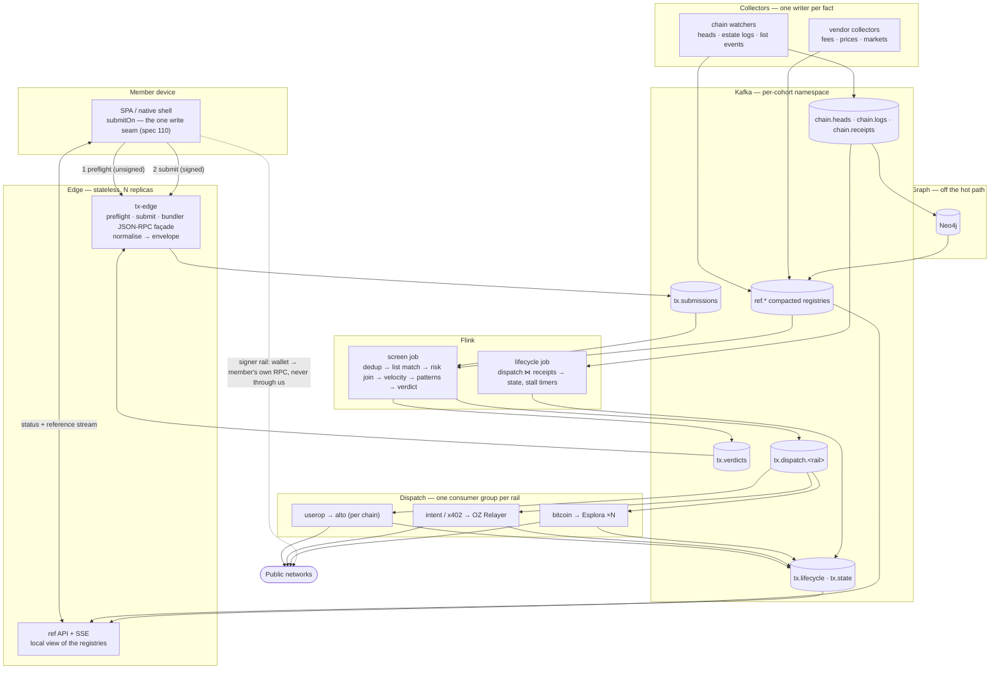
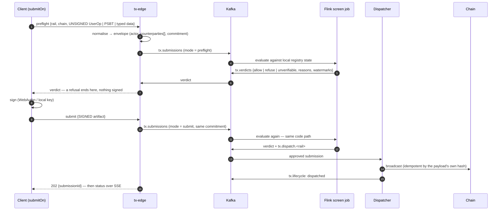
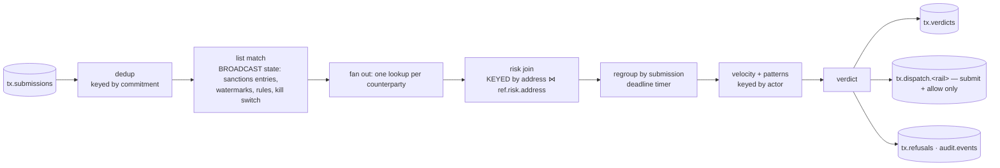

# Streaming Backbone — Kafka / Flink architecture for the transaction lifecycle

> **Status:** proposal, pre-spec. Nothing here is built. It is the input to a set of specs
> (§9), each of which still goes through reservation → specify → plan.
>
> **Scope:** the off-chain half of the platform — how a member's signed UserOp, PSBT or intent
> gets from the device to a chain, what decides whether FairWins facilitates it, and where
> shared data comes from. Contracts are untouched.
>
> **Anchors:** this builds on the [architecture workbook](workbook/README.md) (the index of what
> exists) and the [transaction lifecycle guide](../developer-guide/transaction-lifecycle.md)
> (the client half of the same story). Where this page states a fact about today, §1 says
> whether it was read in the code or taken from those documents.

## 0. The decision in one screen

**What changes.** Three things that are today welded into one single-instance Node process —
*accepting* a submission, *deciding* whether to facilitate it, and *remembering* what happened to
it — become three planes joined by a log:

| Plane | Today | Proposed |
|---|---|---|
| **Accept** | `relay-gateway` (Express) for intents, BTC, paymaster; alto directly for UserOps | A stateless edge with N replicas. Normalises every rail into one envelope and produces it. |
| **Decide** | Inline `await screen.screen(...)`: one `eth_call` per request, signer only | A Flink job over the envelope stream, joined against **replicated registries** held in local state. No network call on the hot path. |
| **Remember** | In-process `Map`s, lost on restart; audit lines on stdout | Kafka: an append-only lifecycle topic plus a compacted current-state topic. |
| **Dispatch** | The same process calls the engine / Esplora | Per-rail dispatchers consuming approved submissions. |
| **Reference data** | Every client and every request reads the chain or the vendor itself | Collectors publish each shareable fact **once** into compacted topics; everyone reads the copy. |
| **Relationships** | None | Neo4j, **off the hot path**, deriving risk tiers that are published back as a registry. |

**What does not change.** No custody; the gateway still cannot sign for a member. Every
FairWins-operated component stays optional — a total outage of this pipeline degrades
convenience and strands nothing. The on-chain `SanctionsGuard` and the issuing tokens remain the
only things that *enforce*.

**Six load-bearing decisions**

1. **Screen before the signature, gate after it — one decision function, two modes.** A refusal
   should sign nothing (§3.1, §4.2).
2. **Registries are replicated sets, not caches of lookups.** The lists that matter are
   enumerable; tail them once and per-address lookups disappear entirely (§5).
3. **Neo4j derives, Kafka serves.** The graph never sits in the synchronous path (§6).
4. **At-least-once to the dispatcher, idempotent by the payload's own hash.** Exactly-once Kafka
   sinks commit on checkpoint and would put seconds of latency on every transaction (§4.5).
5. **A compacted topic has no notion of staleness.** Every registry record carries its own
   freshness and every source has a watermark, or "last write wins" becomes "a dead collector
   reads as healthy" (§5.3).
6. **Shadow first.** The pipeline runs beside the current path, deciding nothing, until its
   verdicts are shown to agree (§8).

**Four places this pushes back on the brief** — §3.

---

## 1. Index of the current estate

Read in the code for this review unless marked *(workbook)* or *(guide)*. Paths are relative to
the repository root; `GW/` is `services/relay-gateway/src/`.

### 1.1 Submission rails — what transits FairWins, and what is screened

This table is the finding that shapes everything else.

| Rail | Path today | Signed artifact passes through FairWins? | Off-chain screening today | Server-side lifecycle record |
|---|---|---|---|---|
| Signer (injected, WalletConnect, hardware, recovered key) | wallet → the member's RPC | **No** | Client advisory only | None (client ledger) |
| Passkey UserOp, sponsored | browser → `GW/server.js` `POST /v1/paymaster` for the grant; browser → `bundler.fairwins.app` (alto) to submit | Yes (alto) | `userOp.sender` only, at the grant (`server.js:820`). `callData` is **not decoded** — recipients are never looked at | None. Client polls `eth_getUserOperationReceipt` |
| Passkey UserOp, self-funded | browser → alto | Yes (alto) | **None** | None |
| Relayed intent (EIP-712 / EIP-3009) | `POST /v1/intents` → OZ Relayer | Yes | Recovered signer (`server.js:660`) | In-process `Map` (`GW/intent/store.js`); a webhook after a restart finds nothing |
| x402 settlement | paywall → OZ Relayer | Yes | Payer (`GW/x402/verify.js`) | **Not registered in the intent store at all** |
| Bitcoin | browser → `POST /v1/bitcoin/:network/tx` → mempool.space | Yes — a **raw signed tx**, not a PSBT (`GW/bitcoin/routes.js:167`) | **None.** The body is checked for being hex and nothing else: no decode, no screen, no dedup, no audit line | None |
| Solana | gateway proxy when configured, else public cluster *(guide)* | Sometimes | None | Status polling not wired *(guide)* |
| Vault (Safe) proposals | signer or passkey rail | As above | As above | On-chain (`safeProposalHub`) |
| Peer EIP-3009 transfer | browser → `VITE_TRANSFER_RELAYER_URL` (`frontend/src/lib/transfer/eip3009Transfer.js`) — a full URL that is **not** the gateway; nothing in this repository serves it | Unknown from this tree | Unknown | None; no status polling |
| OpenSea listing | gateway forwards the signed Seaport order | Yes | None | None |
| Polymarket order | browser → `clob.polymarket.com` directly; the gateway only signs builder headers | No | None | None |

Four facts fall out:

- **The two rails the brief names are the two with the least coverage.** A signed Bitcoin
  transaction is forwarded unread, and a UserOp is screened on its *sender* while the addresses
  it pays are never decoded.
- **There is no place to put a filter for UserOps today.** They go from the browser to alto;
  the gateway only signs sponsorship. Filtering them means fronting the bundler (§4.6).
- **Bitcoin has no screening source of any kind**, client or server: every source in
  `frontend/src/lib/screening/sources.js` is an EVM contract read, and the Bitcoin send flow
  makes no screening call.
- **The client file is called `psbt.js` but no PSBT ever leaves it.** `buildAndSignTx`
  (`frontend/src/lib/bitcoin/psbt.js`) signs, finalises and returns raw hex.

### 1.2 State — all of it in one process

`relay-gateway` holds no database and has no Redis client; the Redis on the node belongs to the
OZ engine and runs with persistence off. The code says so itself: `GW/intent/store.js` and
`GW/policy/dedup.js` are headed "Phase 1 (single instance) … Phase 2: shared Redis", and the
README pins `--max-instances=1`.

| State | Key | Lost on restart means |
|---|---|---|
| Intent store (`intent/store.js`) | intentId, engineTxId | Engine webhooks 404; clients polling `GET /v1/intents/:id` lose their intent |
| Dedup (`policy/dedup.js`) | `chainId:uniquenessMarker` | Replay protection resets (the contract's own nonce is the backstop) |
| Quotas, spend caps, token budgets (`policy/quotas.js`, ~20 instances) | signer / caller / chain | Every limit resets |
| x402 nonce set (`x402/verify.js`) | nonce | Resets (the token's `authorizationState` is the backstop) |
| API-key revocations (`memberApi/revocation.js`) | `account:keyId` | **A revoked key works again** — surfaced honestly as `durable: false` |
| Six TTL caches (OpenSea, Polymarket, Bitcoin, Bridge, Perps, News) | per-vendor keys | Cold cache |
| Kill switch | boolean | Reverts to the env value |

So horizontal scale is not a tuning problem. A second replica would have its own dedup map, its
own quotas and its own half of the intents.

### 1.3 External calls — who asks, and whether the answer is the same for everyone

| Fact | Asked by today | Cached? | Same answer for every member? |
|---|---|---|---|
| Is this address on a sanctions / freeze list | **Every client**: 12 `eth_call`s per address on the mainnet cohort (guard, oracle and issuer lists across five chains), so an address book of N contacts costs N × 12 (`lib/screening/screenEstate.js`, `sources.js`). **The gateway**: one `eth_call` per screened request (`GW/policy/sanctions.js` — no cache) | Client: 60 s per address. Gateway: none | **Yes** |
| Gas price / fee data per chain | Every client per write; gateway per intent | No | Yes |
| Bitcoin fee rates, tip height | Gateway → mempool.space | 30 s | Yes |
| Token prices (Chainlink feeds, V3 `slot0`; POL/USD from CoinGecko on a global 5-minute poll) | Every client | Client-side | Yes |
| `FeeRouter` rates | Every client; gateway (30 s) | Partly | Yes |
| Membership tier of an address | Client; gateway (60 s) | Partly | Yes (public chain state) |
| Markets: Polymarket, perps pairs, news, NFT collection stats | Gateway proxies | 15 s – 1 h | Yes |
| Lido APR, Polygon validators, Morpho vault list | **Browser-direct** *(workbook 06)* | Client | Yes |
| Balances, UTXOs, positions, rewards, wagers of one member | Client; some gateway proxies | Short | No — member-specific |

Everything in the top eight rows is a candidate for "fetch once, serve everyone". The QuickNode
endpoint that alto depends on is capped at **50 req/s shared** between alto, the gateway and the
FinOps exporter (`infra/vm/bundler/docker-compose.yml:62`), so uncached per-request reads are
spending the one budget the bundler cannot do without.

### 1.4 Physical estate

| Fact | Source |
|---|---|
| Two GCE `e2-small` VMs (~2 GB each), one zone, one of each role. Gateway node: gateway + OZ engine + redis + FinOps exporter + Alloy, ~0.9 GB free | `infra/vm/gateway/docker-compose.yml` |
| alto serves **chain 137 only**; ETC 61 and Mordor 63 have no bundler | `infra/vm/bundler/docker-compose.yml` |
| The billing budget is **$60 / month**; the two VMs cost about $32 | `ops/monitoring/apply.sh:117-121` |
| **Staging has no backend.** `relay-staging` was never built; the gasless nodes "exist once, in prod" | `infra/terraform/environments/staging/main.tf` |
| Gateway, engine and exporter images are built and pushed **by hand**; rollout is a compose re-pin merged to `main` | `docs/runbooks/member-api-operations.md` |
| The GCP project is shared with unrelated workloads; IAM is additive-only; Terraform modules live in `chippr-tf-modules` | workbook 03 |
| Paging is one e-mail channel | `infra/terraform/environments/prod/terraform.tfvars` |
| Measured 30-day p99 for the gateway node: 0.2 vCPU / 0.31 GiB | `infra/vm/gateway/docker-compose.yml:22` |

No Kafka, Flink, Neo4j, queue or outbox is declared or referenced anywhere in the tree.

### 1.5 The client tracks everything by polling, and forgets on reload

There is no WebSocket and no `EventSource` anywhere in the client; server push is a stub
(`subscribeToPush` returns `null`). Every confirmation is a poll loop owned by the surface that
started it:

| What | Interval | Where the pending state lives |
|---|---|---|
| UserOp receipt | 3 s, stalled at 90 s | `txProgressBus` — **module memory; lost on reload** |
| Intent status | 4 s, up to 180 s | React state |
| Bitcoin tx status | 15 s, up to 30 min | Memory, including the spent-outpoint locks |
| Bridge reconciler | 15 s | userStorage buffer |
| Activity engine (12 sources) | 30 s, mounted globally | userStorage |
| Portfolio, estate ledger, Earn, staking, perps positions | 60 s each | — |

A member who reloads the tab while a UserOp is in flight has no record that it was sent. A
server-side lifecycle record (§4.4, `tx.state`) is what a status stream reads from, and it is
also the thing that makes "I closed the app" survivable.

**The write seam is not finished.** `lib/chains/submitOn.js` is the one-place-a-write-chooses-
its-chain of spec 110, but it has no production caller yet: task T028 is open, and the rail is
still decided in several places (`WalletContext.sendCalls`, `submitAsActiveAccount`,
`useIntentAction`, `useTransfer`), with some 35 files branching on `loginMethod === 'passkey'`.
That matters here because a preflight call wants exactly one place to live (§4.2).

### 1.6 Documentation that contradicts the estate

`docs/developer-guide/architecture.md` still says the platform has "no application backend" and
that "new features must not introduce an application backend" (workbook finding C1). The
constitution names the stack as Hardhat, React/Vite and The Graph and requires a new core
technology to be justified in a plan. This proposal introduces four (Kafka, Flink, Neo4j, a JVM
build). §9 lists the amendments that have to land with the first spec.

---

## 2. Constraints the design must hold

These are existing platform invariants, restated because each one rules out an otherwise obvious
design.

| Invariant | What it rules out here |
|---|---|
| **No custody; the gateway cannot sign for a member** | Any server-side "fix-up" of a submission. The pipeline forwards the member's bytes or refuses them. |
| **Never stranded** — every off-chain component is optional | Making the pipeline the *only* route to a chain. With it down, a member with a signer still self-submits. |
| **Three verdicts, not two** — unreadable is never a negative, and never a positive | A boolean verdict. A registry that has not synced is `unverifiable`, which is neither `clear` nor `flagged`. |
| **Fail closed on facilitation** — `503 screening_unavailable`, never "probably fine" | Falling back to "allow" when Kafka or Flink is unreachable. |
| **A refusal signs nothing** | Discovering a refusal only after the WebAuthn ceremony. |
| **Cohort isolation** — testnet and mainnet never mix | One topic namespace for both. Enforced by broker ACL, not by naming discipline. |
| **The member's RPC is the member's** (spec 069) | Forcing reads through a FairWins data plane. The shared plane is offered, not imposed. |
| **At most one alto per (chain, executor key)** | Scaling the bundler by adding altos. Dispatchers scale; alto does not. |
| **Every cost source is in the FinOps catalogue** | Standing this up without catalogue entries — `check:finops` fails. |
| **The root lockfile is fragile** (spec 075, npm/cli#4828) | Adding a Kafka client with platform-native optional binaries to the npm workspace. |
| **Member data stays on the member's device** | Treating the log as a free place to keep things (§7). |

---

## 3. Where the brief needs sharpening

### 3.1 A signed UserOp or transaction is a bearer instrument

Once it is signed, anyone can broadcast it: any v0.6 bundler takes the UserOp, any Bitcoin node
takes the transaction. A filter placed after the signature therefore **cannot prevent** anything.
It decides one thing — whether *FairWins* carries it. That is the right objective ("not being
facilitated" is exactly the legal posture), but it has two design consequences:

- The filter only has real leverage where FairWins supplies something scarce: the paymaster's
  sponsorship signature and the relayer's gas are hard choke points; bundling and Bitcoin
  broadcast are soft ones. §6.4 follows this through.
- **The useful place to screen is before the signature.** A member refused after signing is
  holding a live instrument and an error; a member refused before it has signed nothing. So the
  frontend should send the *unsigned* artifact first (§4.2).

### 3.2 PSBT is the right wire format — for a reason beyond signing

Today the client sends finished raw hex. A raw transaction names its inputs only as
`txid:vout`, so screening the **input** side needs an indexer lookup per input. A PSBT carries
each input's previous output (`witness_utxo`), which means the addresses on both sides can be
derived with **no external call** — and the signature commits to those previous outputs (BIP-143
amounts, BIP-341 amounts and scripts), so they cannot be forged without invalidating the spend.
The wallet only ever derives BIP-84 and BIP-86 keys, so the transaction id is independent of the
witness: the unsigned PSBT and the final transaction share one id, which is the natural
correlation key between preflight and submit. `@scure/btc-signer`, already in the client, emits
PSBTs.

### 3.3 Neo4j and compacted registries are not alternatives

The experiment treated them as two candidate filters. They are two layers. A graph database in
the synchronous path makes submission latency equal to Neo4j's p99 and submission availability
equal to the product of both systems'. Used as the **derivation** layer — computing which
addresses sit near a flagged cluster and publishing that as a registry — it costs the hot path
nothing (§6).

### 3.4 This is not justified by throughput, and should not be sold that way

The gateway node's measured p99 is a fifth of one shared vCPU. The estate runs on a $60 monthly
budget. Kafka plus Flink plus Neo4j is a cost step of one to two orders of magnitude (§7.3) and
would be absurd as a response to load. What it actually buys:

1. A screening point that **exists** for the two rails that have none.
2. Lifecycle state that survives a restart, which is also what permits a second replica.
3. Shared reference data, which is what relieves the RPC budget.
4. **Replay.** A rule change can be run against last month's submissions before it goes live.
   No request/response design gives that.

If only (2) were wanted, the Redis the code already anticipates would do it for a few dollars.
The case for a log rests on (1), (3) and (4) together.

---

## 4. Target architecture

### 4.1 Planes



### 4.2 Preflight and submit — one function, two modes



- **There is one decision function.** Preflight and submit are the same job reading the same
  state; the only difference is that a preflight verdict is never dispatched. That is
  deliberate: a separate "advisory" implementation would drift from the gate, and this repo has
  paid for that pattern before.
- **The commitment is signature-independent**, so both phases correlate without a token:
  for Bitcoin the transaction id (§3.2); for a UserOp
  `keccak(chainId, entryPoint, sender, nonce, initCode, callData)` — the userOpHash minus the
  fields that sponsorship and signing fill in.
- **The paymaster grant becomes a preflight with teeth.** `pm_getPaymasterData` already sees the
  whole unsigned UserOp; it signs only on an `allow` verdict for that commitment. That binds the
  one hard choke point to the full decision rather than to `sender`.
- **The signer rail gets preflight only.** The wallet broadcasts to the member's own RPC and
  FairWins never sees the signed transaction — correctly. Preflight belongs in `submitOn`, so
  that the member gets the same verdict on every rail: advisory where we do not carry the
  transaction, a gate where we do. **That makes closing spec 110 T028 a prerequisite** for
  universal preflight (§1.5). Until it closes, the gate still holds — it is server-side, on the
  rails we carry — but a surface that bypasses the seam discovers a refusal after signing.
- **Async is the contract.** `202` plus a status stream is what the intent rail already does;
  this makes it the shape of every rail. The bundler façade (§4.6) is the one place that blocks
  briefly, so that viem's bundler client keeps working unmodified.

### 4.3 The envelope

Flink should match on normalised entities, not parse calldata. The edge — which already carries
viem, the intent types and the ABIs — produces one shape for every rail:

```text
SubmissionEnvelope {
  submissionId, mode: preflight | submit
  cohort, tenantId
  rail: userop | intent | x402 | bitcoin | …
  family: evm | bitcoin | solana,  chain: number | string
  actor                      // recovered or declared sender — never a client-asserted label
  counterparties[] {address, role: recipient | spender | target | input | factory | paymaster,
                    asset?, amount?}
  decodeCoverage: full | partial      // partial = calldata we could not read
  commitment                 // §4.2
  payload                    // the member's exact bytes; absent on preflight records
  callerTier                 // spec 106 identity tier — for rate limits, not for verdicts
}
```

- `counterparties` comes from one deterministic extractor: `executeBatch` → calls → ERC-20
  `transfer` / `approve` / `transferFrom` / `permit`, EIP-3009, Safe `execTransaction` and
  MultiSend, the routers in `@fairwins/abi`; for a PSBT, every input's previous-output script
  and every output script.
- **`decodeCoverage: partial` is first-class.** Calldata the extractor cannot read yields the
  target contract as the only counterparty and says so. The rules decide what partial coverage
  means; the extractor never guesses — the same stance `describeProposal` takes ("null over a
  guess").
- **The dispatcher re-derives `commitment` from `payload` before broadcasting.** The envelope is
  a claim about the bytes; the bytes are what reach the chain.
- Schemas are Protobuf, in one package resolvable by plain Node (spec 075 rule 3) with generated
  Java for the jobs, and a CI gate on backward compatibility.

### 4.4 Topics

Names are `<cohort>.<domain>.<entity>.v<n>`. Cohort is the first segment so that isolation is a
**prefix ACL on the broker**, enforced by credentials rather than by everyone remembering.

| Topic | Key | Cleanup | Carries |
|---|---|---|---|
| `tx.submissions` | `family:chain:actor` | delete, days | Envelopes. Keyed by actor so one account's operations stay ordered (nonces). |
| `tx.verdicts` | submissionId | delete, days | Verdict, reason codes, policy version, the registry watermarks it was decided against. |
| `tx.dispatch.<rail>` | `chain:actor` | delete, days | Approved submissions with payload. One topic per rail so rails scale and fail independently. |
| `tx.lifecycle` | submissionId | delete, weeks | Append-only events: accepted, screened, dispatched, observed, included, failed, replaced, stalled. |
| `tx.state` | submissionId | **compact** | Current state per submission; tombstoned a fixed time after a terminal state. What the SSE endpoint serves. |
| `tx.refusals` | commitment | delete, long | Commitment, reason codes, policy version, watermarks. **No payload** (§7.1). |
| `ref.sanctions.entry` | `source:family:address` | **compact** | `{listed, sinceBlock, evidence}` per list entry. |
| `ref.sanctions.watermark` | `source:chain` | **compact** | `{syncedTo, observedAt, state}` — how fresh each list is (§5.3). |
| `ref.risk.address` | `family:address` | **compact** | Graph-derived tier, model version, as-of. |
| `ref.policy.rule` · `ref.killswitch` | ruleId · scope | **compact** | Rules as data, replacing the SIGHUP reload. |
| `ref.fee.gas` · `ref.fee.btc` · `ref.price` · `ref.feerouter` · `ref.membership` · `ref.market.*` | natural key | **compact** | Shared reference facts (§5). |
| `chain.heads` · `chain.logs.<chain>` · `chain.receipts` | chain · log id · tx hash | delete / compact | What the watchers observed. |
| `audit.events` | — | delete, sunk to WORM storage | The audit record, replacing stdout. |
| `tx.deadletter` | — | delete | Anything a stage could not process, with the reason. |

Dedup, quotas and velocity are **Flink keyed state**, not topics.

### 4.5 The screen job



- **Two kinds of state, chosen by size.** The lists are small — thousands of entries — so they
  ride in *broadcast* state, present on every parallel task. Graph-derived risk is potentially
  millions of addresses, so it is *keyed* state: each submission fans out one lookup per
  counterparty, keyed by address, and regroups under a deadline timer.
- **The deadline expires to `unverifiable`.** A lookup that does not return is not a clear.
- **The verdict has four values**, and the mapping to an action is rule data per rail:

  | Verdict | Meaning | Default action on a facilitated rail |
  |---|---|---|
  | `allow` | Every configured list answered clear and is fresh | dispatch |
  | `refuse` | A list hit, or a hard rule | refuse, `403`, reason named |
  | `unverifiable` | A required list is stale or unsynced | refuse, `503` retryable — never a denial |
  | `review` | Graph tier or pattern, no list hit | policy decision (§6.4) |

- **Delivery is at-least-once, on purpose.** Flink's exactly-once Kafka sink commits its
  transaction at the checkpoint, so a `read_committed` consumer sees records only once per
  checkpoint interval — seconds of latency on every submission. The dispatch topic is therefore
  at-least-once, and duplicates are absorbed where they are free: the userOpHash, the Bitcoin
  txid and the intent's `uniquenessMarker` are each already an idempotency key that the bundler,
  the node and the contract reject on repeat. Exactly-once is reserved for the audit sink.
- **Replayed records must not double-count.** Velocity counters key their increments by
  commitment so a restart that replays ten seconds of input does not charge those submissions
  twice.
- **Latency budget.** Produce with `acks=all` ≈ 10 ms; the job with a short buffer timeout and no
  windowing on the hot path ≈ 10–30 ms; the reply consume ≈ 10 ms. A target of p99 under 250 ms
  for preflight is realistic and should be a measured exit criterion, not an assumption. For
  scale: the WebAuthn ceremony takes seconds and a Polygon block about two.
- **Fraud rules worth having on day one**, all expressible over the envelope:
  - *Address poisoning* — a recipient that matches the first and last characters of an address
    in the actor's history but is not that address.
  - *Approval to a known drainer*, and unlimited approval to an unverified contract.
  - A UserOp whose `initCode` factory is not the FairWins factory, or whose paymaster is not ours
    on the sponsored path.
  - A Bitcoin output carrying an `OP_RETURN` or a script type the wallet never produces.
  - A fresh account draining to a single new address within minutes of a credential change.

### 4.6 Dispatch, and fronting the bundler

| Rail | Dispatcher | Note |
|---|---|---|
| UserOp | `eth_sendUserOperation` to that chain's alto, on an internal address | alto stops being publicly reachable. `bundler.fairwins.app` becomes a JSON-RPC façade at the edge: `eth_sendUserOperation` maps to submit and waits briefly for the verdict; estimation, receipts and `eth_supportedEntryPoints` pass through. The client's `bundlerTransport` failover is unchanged. **The single-alto invariant is untouched** — dispatchers multiply, altos do not. |
| Intent, x402 | OZ Relayer, as now | The engine's webhook writes to `tx.lifecycle` instead of an in-process map, which fixes the post-restart 404 and brings x402 settlements into the record. |
| Bitcoin | Esplora, with more than one upstream | Today there is one upstream and no retry. |

### 4.7 Observing — closing the loop

Chain watchers publish heads, the estate's logs and the receipts of dispatched transactions. A
second Flink job joins `dispatched` against `receipts` and owns the stall timers.

Two things follow that the estate does not have today. **"Dispatched but unconfirmed for longer
than N" becomes a metric.** The 2026-07-12 incident — operations mined, confirmations never
surfaced, health check green throughout — is exactly a growing population of submissions in that
state, and nothing was positioned to count it. And the same `chain.logs` topic can replace three
separate scanners that each walk the chain on their own: the FinOps exporter's log scans, the
client's event scans on chains with no subgraph, and the activity ledger.

---

## 5. The reference plane — fetching each fact once

### 5.1 Classify first

| Class | Examples | How it is sourced | Calls after |
|---|---|---|---|
| **A. Enumerable public sets** | Sanctions and freeze lists, `SanctionsGuard` deny list, `FeeRouter` config, membership, callsigns, mini-app registry | **Tail the events once.** The whole set is replicated; lookups become local set membership. | O(changes), not O(lookups) |
| **B. Global scalars** | Gas per chain, Bitcoin fee rates, tip heights, feed prices, Lido APR, validator lists, market lists | One collector polls or subscribes; everyone reads the published value. | One poller, regardless of member count |
| **C. Long-tail public facts** | Token metadata, collection stats, ENS names | Filled on first demand, shared, with a TTL. | One per key per TTL |
| **D. Member-specific** | Balances, UTXOs, positions, rewards | **Not shared, and never in a topic** (§7.1). Pass through as today. | Unchanged |

Class A is where the largest saving is, and it is a different idea from caching. A cache answers
"what did the list say about address X the last time someone asked?" A replicated set answers
"is X in the list as of block N?" for every X, including ones nobody has asked about yet.

For sanctions specifically: `SanctionsGuard` emits `DenyListUpdated` (in this repository). The
Chainalysis oracle and the Circle and Tether tokens also emit an event per add and remove — the
exact event names must be confirmed against the deployed ABIs before this is built, and any list
that turns out not to be fully enumerable from events falls back to periodic reconciliation
rather than being assumed complete. **Bitcoin needs a new source**: the OFAC SDN list publishes
digital-currency addresses directly and is free; that is a legal decision as much as a technical
one (§10).

### 5.2 Serving it

Each edge replica consumes the compacted `ref.*` topics into memory at boot and serves them from
there: `GET /v1/ref/…` for a read, and one multiplexed SSE stream for changes, which also carries
`tx.state`. A client then subscribes once instead of running the dozen independent poll loops of
§1.5. (SSE rather than WebSocket: it is plain HTTPS, passes the existing Cloudflare and nginx
path unchanged, and the client only needs one direction.)

**The plane is offered, never imposed.** A member who points the app at their own node (spec
069) keeps reading their own node; the client falls back to direct chain reads whenever the
plane is unreachable or stale.

### 5.3 A compacted topic keeps the last value forever

This is the one place where Kafka's semantics cut directly against a platform rule. Compaction
retains the newest record per key with no expiry, so a collector that died an hour ago leaves
behind a record that reads as perfectly healthy. "A zero is never an absence" has an exact
counterpart here: *an old value is never a current one*.

- Every record is a three-state reading, mirroring `reading.js`:
  `{state: read | unreadable | not-configured, value?, source, asOf, block?, ttlMs}`. Only `read`
  carries a value.
- **Staleness is evaluated by the reader at read time** (`asOf + ttlMs`), never trusted from the
  record's presence.
- Every source has a **watermark** (`ref.sanctions.watermark`): how far it has synced and when it
  last made progress. An address absent from a list is "clear as of block N", and that claim is
  only as good as N. A stale watermark makes every lookup against that list `unverifiable`.
- A list entry that is removed is written as `listed: false` before it is tombstoned, so a
  consumer that was mid-read cannot mistake a removal for never-listed.

### 5.4 Shared data is advisory unless a ceiling protects it

A per-client read fails independently; a shared record that is wrong is wrong for everyone at
once. So the rule for what may come from the plane on a value path is: **only numbers the
member's signature already bounds.** A platform-fee rate is passed as `maxFeeBps` and a Bitcoin
fee as a signed ceiling, so a wrong figure costs at most what the member consented to, or makes
the transaction revert. Balances, allowances and anything unprotected stay direct reads. Every
record carries enough provenance (source, block) for a client to spot-check it.

---

## 6. The graph plane

### 6.1 Model

```text
(:Address {family, id})-[:TRANSFER {asset, amount, block}]->(:Address)
(:Address)-[:IN_CLUSTER]->(:Entity {kind: sanctioned | mixer | drainer | exchange | …})
(:Address)-[:FLAGGED_BY {since}]->(:Source)
```

### 6.2 Scope it, or it is the exporter incident again

A graph of every transfer on a chain is a big-data project: asking Polygon USDC for every
`Transfer` is precisely what killed the FinOps exporter 5,966 times. The graph is an
**ego-network**: seeded from flagged entries and expanded a bounded number of hops outward, plus
addresses that actually appear as counterparties in submissions, enriched lazily. Every scan is
filtered on chain by an indexed topic and bounded by block range.

### 6.3 Flow

`chain.logs` and the list registries feed Neo4j through a sink connector. A periodic job computes
a tier per address — hops to the nearest flagged cluster, exposure, recency — and publishes it to
`ref.risk.address`. The screen job reads that topic as keyed state. An address with no record is
`unknown`: it is queued for enrichment and the rule for `unknown` decides the action.

### 6.4 Mechanism design

**What the gate binds.** By rail, in decreasing order of leverage:

| Resource | Substitutable by the member? | What a refusal costs them |
|---|---|---|
| Paymaster sponsorship | No — only our signer can sponsor from our deposit | They pay their own gas |
| Relayer gas | No | They self-submit |
| Bundling | Yes — any v0.6 bundler | In principle nothing; **in practice everything**, see below |
| Bitcoin broadcast | Yes — any node | In principle nothing |

**False positives are cheap only where exit is real.** Because the platform never holds funds, a
wrongly refused member has lost convenience, not money — which would let thresholds be set
tighter than a custodian could tolerate. That holds for a member with an injected wallet. It does
**not** hold for a passkey-only member: their exit is "submit this UserOp to some other bundler",
which the app does not offer and a non-technical member cannot do. For them a refusal is a block
with custodial-grade cost. Two consequences: graph tiers and pattern matches should produce
`review` — disclose, slow down, ask for confirmation — and reserve outright refusal for list
hits; and a refusal on the passkey rail needs a stated way to contest it.

**Preflight is a free oracle.** List verdicts leak nothing; those lists are public on-chain. But
graph tiers and pattern rules are a model, and an endpoint that answers "would this be flagged?"
lets an adversary probe it until a route passes. Return coarse reason codes for anything not
list-derived, rate-limit preflight by the caller's identity tier (spec 106), and never
distinguish heuristic sub-reasons in a response.

**Address lists price evasion at one hop.** Moving funds through a fresh address defeats list
screening for the cost of one transfer. Graph proximity raises that to a function of hops, fees
and time — a real increase, not immunity. The honest claim to make of this system is
"FairWins did not carry it, and can show what it knew when it decided", which is why
`tx.refusals` records the policy version and registry watermarks behind every decision.

**Sponsorship quotas are sybil-cheap.** They are keyed by `sender`, and a counterfactual account
costs nothing to create. The graph offers a better key — the funding cluster.

---

## 7. Custody of data, deployment and cost

### 7.1 The log is a new thing to be careful with

The platform's posture is that member data lives on the member's device. A durable log of
submissions is the first server-side record of member activity, and it should be designed as a
liability:

- **No IP address, user agent or session identifier ever enters a topic.** Identity tier does;
  identity does not.
- **Refused payloads are not retained.** `tx.refusals` holds the commitment and the reasons. An
  accepted payload becomes public the moment it is broadcast; a refused one never does, and
  keeping it would create a record of intent that exists nowhere else.
- Short retention on anything carrying payloads; `tx.state` tombstoned a fixed time after a
  terminal state.
- **Class D data never enters a topic.** An address-keyed record is published only when it was
  produced independently of any member's request (list replication, graph expansion from flagged
  seeds) — never as a by-product of someone looking something up.
- The privacy notice is amended with the first phase that retains anything.

### 7.2 Where it runs

Nothing here fits on the existing nodes; the gateway node has under a gigabyte free and Flink and
Neo4j are each JVM workloads wanting several.

| Component | Recommended first footprint | Alternative |
|---|---|---|
| Kafka | Managed, in the existing project (GCP Managed Service for Apache Kafka), declared in `chippr-tf-modules` | Self-hosted KRaft on three small VMs — cheaper, and three more stateful things to operate with one e-mail channel for paging |
| Flink | Application-mode jobs on a small dedicated node or GKE Autopilot, checkpoints in GCS | A managed Flink service — check availability and whether it supports the DataStream API, which the broadcast and keyed-join patterns need |
| Neo4j | One VM, Community edition, not in the hot path so a restart costs nothing | A managed instance |
| Edge, dispatchers, watchers | Small stateless containers | — |

A backend staging environment does not exist today and must be built as part of this: the
testnet-cohort cluster is the natural staging.

### 7.3 Cost

Not priced here, deliberately — a figure would be arithmetic over list prices I have not
verified. The honest statement is the order of magnitude: the estate costs about $32 a month and
is budgeted at $60; a minimal managed Kafka, a Flink node and a Neo4j node will be **several
hundred dollars a month**. The plan for the first phase must price it, reset the budget alert,
and add `billed` catalogue entries — `check:finops` will fail the change otherwise, which is the
gate doing its job.

### 7.4 Repository shape

| New | Where | Why there |
|---|---|---|
| Event schemas | `packages/event-schemas` | One source for Node and Java; plain-Node resolvable |
| Envelope extractor | `packages/tx-envelope` | Shared by the edge and by tests; deterministic and pure |
| Flink jobs | `services/stream-jobs/` (Java 17; Flink 2.x removed the Scala API) | **Outside the npm workspace**, like `contracts/` and `mcp-server` |
| Kafka-speaking Node services | Outside the workspace, or on a pure-JavaScript client | Clients built on librdkafka ship platform binaries as optional dependencies — the exact shape of npm/cli#4828 |
| Terraform | `chippr-tf-modules`, SHA-pinned | Workbook 03 |

New gates: schema backward-compatibility; a **decision-parity** gate that runs a recorded set of
submissions through the job on a Flink mini-cluster and compares verdicts; `check:finops`;
`check:iac`.

---

## 8. Migration

Each phase ships on its own, is reversible by a flag, and leaves the platform no worse if the
next one never happens.

| Phase | Ships | Member-visible change | Exit criterion |
|---|---|---|---|
| **0. Record** | The gateway emits lifecycle events *after* its existing decision — produce failures never fail a request. Watchers. The screen job runs in **shadow**, deciding nothing. | None | Shadow verdicts agree with inline ones over a stated window; stall detection fires on an injected stall |
| **1. Reference plane** | List replication, watermarks, shared scalars, `/v1/ref`, the SSE stream. Gateway screening reads local state, falling back to the on-chain read when a watermark is stale. Client estate screening reads the plane, falling back to direct reads. | Faster screening pill; fewer spinners | Screening reads per address fall from 12 to 0 on the client and from 1 to 0 on the gateway, measured; QuickNode headroom |
| **2. Gate** | Preflight and submit. Bitcoin moves to PSBT and is screened. The bundler façade. Paymaster grants require a verdict. Edge replicas > 1. Status over SSE, surviving a reload. Depends on spec 110 T028. | Refusals arrive before signing; an in-flight transaction is still there after a reload | p99 preflight latency; zero dispatched-without-verdict |
| **3. Graph** | Neo4j, risk tiers, pattern rules, the `review` path. | Step-up prompts on risky sends | False-positive rate on recorded traffic, measured by replay **before** enabling |
| **4. Retire** | In-process maps removed; rules-as-data replaces the reload signal. | None | — |

Phase 0 is the cheapest way to find out whether the rest is worth it: it produces the real
submission volume, the real decode coverage, and the real disagreement rate, for the cost of one
small cluster.

---

## 9. What has to land alongside

- **Specs.** One per phase at least; phase 2 probably splits into Bitcoin and UserOp. Numbers are
  claimed by reservation PR, not here.
- **Constitution.** A MINOR amendment: name the backend stack, and add a principle for
  server-side data custody (§7.1) — today the constitution is silent on it.
- **`architecture.md`.** Retire "no application backend" (workbook C1).
- **Legal.** Privacy notice, with the first phase that retains submissions.
- **FinOps catalogue.** Cost entries with the first cluster.
- **CLAUDE.md.** A guardrail paragraph per shipped phase, as for every other subsystem.

## 10. Decisions that are the owner's

1. **Budget.** Managed versus self-hosted, and the monthly ceiling. Everything else is downstream
   of this.
2. **What `review` does.** Refuse, step-up, or disclose-and-proceed — and whether it differs for
   passkey members (§6.4).
3. **A Bitcoin sanctions source.** The OFAC list directly, or a paid risk provider. The estate
   deliberately uses no off-chain risk provider today.
4. **Whether the signer rail's preflight is ever more than advisory.** Recommended: no — we do
   not carry those transactions.
5. **Retention periods**, and the privacy wording that goes with them.
6. **Tenancy.** One cluster with a tenant field, or a cluster per dedicated tenant. On-chain
   isolation is already per tenant; the log should follow whichever the tenant contract promises.

## Appendix — what was and was not verified

- **Read in the code:** the Bitcoin broadcast route, the paymaster pipeline, `sanctions.js`, the
  in-process stores and their "Phase 2" headers, the budget, the shared RPC cap, the screening
  source registry, the constitution.
- **Read in the client code by a delegated sweep, spot-checked here:** the submission rails,
  the polling inventory, the screening read count, the state of the spec 110 seam.
- **Taken from the workbook and the lifecycle guide:** the vendor inventory, the node
  interiors, Solana behaviour.
- **Unknown:** what serves `VITE_TRANSFER_RELAYER_URL` (§1.1). It is referenced by the client
  and by nothing else in this repository.
- **Not verified:** the add/remove event names on the Chainalysis oracle and the Circle and
  Tether tokens (§5.1); current pricing and feature coverage of managed Kafka and Flink
  offerings (§7.2–7.3); the latency budget (§4.5), which is an estimate until measured.
