# Transaction Lifecycle — from initiation to final state

> **Scope.** This guide follows one member-initiated write through the app, from the tap to its
> final state. It covers the network-agnostic model introduced by **spec 110** (*the chain is a
> property of the action, not of the wallet*). It explains:
>
> - where accounts are stored and who is acting;
> - how the target network is chosen;
> - fee and price estimation;
> - screening and enrichment;
> - signing, broadcast, and tracking to a terminal state.
>
> It describes the code as it stands (v1.19.x). Each section names the files that hold the
> behaviour. Where this guide and the code disagree, the code wins — open an issue.
>
> Related guides: [gasless-intents](gasless-intents.md) · [passkey-accounts](passkey-accounts.md) ·
> [protect-policies](protect-policies.md) · [address-screening](address-screening.md) ·
> [platform-fees](platform-fees.md) · [network-endpoints](network-endpoints.md) ·
> [chain-estate-reads](chain-estate-reads.md) · [bitcoin](bitcoin.md) · [activity-ledger](activity-ledger.md).

---

## 0. The model in one paragraph

Every write is the product of three independent facts:

| Fact | What it is | Where it comes from |
|---|---|---|
| **Target chain** | The network the write lands on | The **action or asset**: the wager's `chainId`, the vault instance, the coin picked in Wrap. Never the wallet's ambient chain (spec 110 FR-001). |
| **Acting identity** | The account the write is performed **as** | `CustodyContext.active`: personal, vault, legacy (recovered), or hardware |
| **Write rail** | **How** the write reaches its chain | `resolveWriteRail`. Decided by the **signer** and the target chain, never by `loginMethod`. |

These three are orthogonal. The connected wallet's chain decides only *how* a write is routed
(does the signer rail need a switch first?). It never decides *where* the write lands.

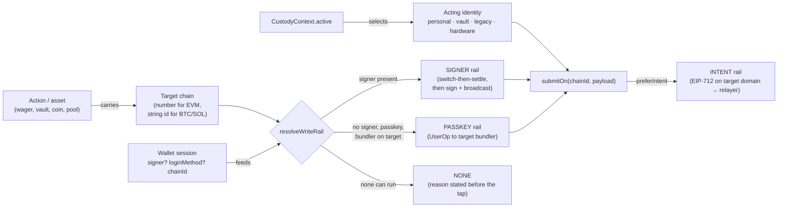

---

## 1. Lifecycle overview

The stages below are the same on every network and every rail. Only the implementation behind
each box changes.

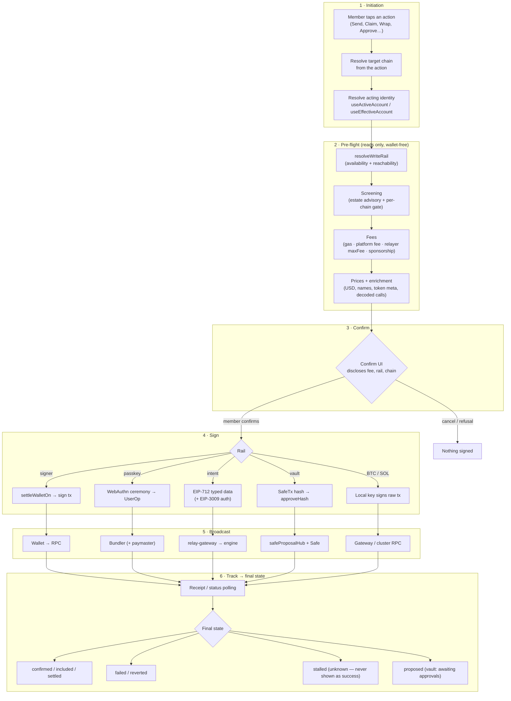

**Invariants that hold across every stage**

1. **A refusal signs nothing.** Every throw in the seam happens before a rail is handed the payload.
2. **Unreadable is never zero.** Each read resolves three-state (`read` / `not-deployed` /
   `unreadable`), and the confirm UI never fills a gap with `0`.
3. **Availability is stated before the tap.** A rail that cannot run says so, names the chain,
   and names the way out (spec 088/110 FR-005).
4. **One write, one chain.** Atomicity is per chain. Nothing in the app spans chains in one
   transaction.

---

## 2. Network identity

### 2.1 Three namespaces, kept apart by type

| Family | Id type | Registry | Guard |
|---|---|---|---|
| EVM | `number` (`chainId`) | `frontend/src/config/networks.js` → `NETWORKS` | `NETWORKS[id]` strict lookup; `isEvmOption` (`lib/assets/networkPin.js`) |
| Bitcoin (spec 061) | `string` (`'bitcoin'`, `'bitcoin-testnet'`) | `config/bitcoinNetworks.js` | `isBitcoinNetworkId` |
| Solana (spec 063) | `string` (`'solana'`, `'solana-devnet'`) | `config/solanaNetworks.js` | `isSolanaNetworkId` |

String ids must never reach `getContractAddressForChain`, wagmi, the subgraph, or the EVM write
seam. The type is the discriminator: `SelectableAsset.chainId` is a number for EVM and a string
otherwise, so pair and bridge pickers exclude non-EVM options *with a stated reason*
(`nonEvmReason`).

### 2.2 The cohort bounds everything

A build is either mainnet or testnet. `cohortChainIds()` (`config/networks.js`) is the set of
chains it may touch, and constitution III forbids crossing it. Every multi-chain read (portfolio,
screening, vault queues, estate wagers) iterates the cohort, never `listSupportedChainIds()`.
Screening further subtracts local-only chains (`screeningChainIds()`), because a Hardhat guard at
`127.0.0.1` is not a source a shipped build can ever reach.

A few concerns have **one reference chain per cohort**:

- membership: `membershipChainId()` → Polygon or Amoy;
- the mini-app registry: `miniAppChainId()` → Polygon or Mordor.

Writes for those concerns always target the reference chain.

### 2.3 Capabilities decide what a chain can carry

`NETWORKS[id].capabilities` (and `config/networkCapabilities.js`) say whether a chain has:

- a DEX;
- Earn;
- liquidity;
- passkey accounts;
- a subgraph.

`getPasskeySupport(chainId)` (`config/passkeySupport.js`) returns
`{supported, reason, bundlerConfigured, stackDeployed, entryPoint, accountFactory, sponsored}`.
It needs a deployed EntryPoint and account factory **and** a configured bundler URL
(`VITE_BUNDLER_URLS_<NET>`). ETC 61 and Mordor 63 have no bundler, which is why rail resolution
has to exist at all.

### 2.4 The read seam (wallet-free on every chain)

`lib/chains/publicClient.js` builds **one viem `PublicClient` per chain**. Clients are cached on
the resolved route, and endpoints are resolved by `lib/network/rpcEndpoints.js#resolveRpcEndpoints`
with this precedence:

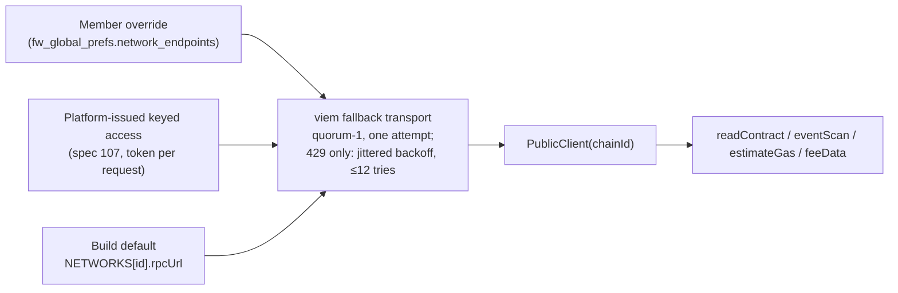

Rules:

- Member credentials ride in a **header**, attach to the primary transport only, and are never
  written into a URL.
- Issued tokens ride per request (`onFetchRequest`) and never key the cache.
- Never hand-build a provider from `NETWORKS[id].rpcUrl`.

Estate reads return `chainReadResult.js` shapes:

- `readOk(chainId, value, unit)`
- `notDeployed(chainId)`
- `unreadable(chainId, reason)`

`value` exists only on `read`, so `?? 0` has nowhere to live. `aggregate()` returns per-unit
subtotals only and never a cross-unit grand total.

---

## 3. Account storage and acting identity

### 3.1 What is stored where

```mermaid
flowchart TB
  subgraph DEV["Device (localStorage / sessionStorage)"]
    direction TB
    PS["fairwins.passkey.session.v1<br/>{address, chainId, credentialId, loginMethod}"]
    PC["fairwins.passkey.credentials.v1<br/>{credentialId, publicKey{x,y}, prfCapable, label, address?}"]
    WS["fairwins.passkey.wrappedSeeds.v1<br/>'acct:credId' → {v, iv, ct} (AES-GCM under PRF→HKDF KEK)"]
    GP["fw_global_prefs<br/>(endpoints, app-lock, nav, favorites)"]
    AP["fw_account_profiles_v1<br/>(card image/tint/pattern)"]
    BL["fairwins.bitcoin.ledger.v1<br/>(issued receive addresses, gap 20)"]
  end
  subgraph USR["Per-account userStorage: fw_user_&lt;addr&gt;_&lt;key&gt;"]
    direction TB
    LK["legacy_recovered_keys<br/>v1: PBKDF2-650k → AES-GCM<br/>v2: PRF → HKDF 'fairwins-legacy-kek-v1'"]
    HW["hardware_accounts<br/>{address, vendor, path, label, addedAt}"]
    VR["custody_vault_references<br/>{address, chainId, label, role}"]
    VC["vault_creation_records<br/>{owners, threshold, saltNonce, rules} — immutable"]
    AB["address book · ledger client records · prefs"]
  end
  subgraph MEM["Memory only — never persisted"]
    MS["Passkey master seed (32 B)"]
    ACT["CustodyContext.active"]
    SG["legacySigner / hardwareSigner"]
  end
  subgraph BAK["Encrypted backup (spec 032)"]
    BB["ChaCha20-Poly1305 bundle<br/>key = keccak(sig or seed ‖ 'FairWins Data Backup v1')<br/>pointer: backupRegistry on Polygon"]
  end
  LK & HW & VR & VC & AB -->|syncedObjects| BB
  WS -->|unwrap with PRF| MS
```

| Store | Contents | Secret? | In `syncedObjects`? |
|---|---|---|---|
| Passkey credentials | Public key and credential id. The private key never leaves the authenticator. | No | No |
| Wrapped seeds | Master seed ciphertext, one entry per controller credential | Ciphertext | No |
| Legacy recovered keys | Private key or mnemonic, **encrypted** (v1 passphrase, v2 passkey-PRF) | Ciphertext | Yes (`legacyRecoveredKeys`) |
| Hardware accounts | Public metadata only: no xpub, no device id | No | Yes |
| Vault references | `(chainId, address)` per instance | No | Yes (network-scoped) |
| Vault creation records | Replay input for "Add a network" (spec 105) | No | Yes |
| RPC endpoints / credentials | Member's RPC endpoints, plus headers | Credential | **Deliberately not** |
| GutterToken key, API keys, account profiles | Device-scoped settings | Mixed | **Deliberately not** |

Key derivation for non-EVM networks:

- **Bitcoin.** `deriveBtcSeed(masterSeed)` runs HKDF-SHA256 with info `fairwins-btc-seed-v1`,
  then BIP84 `m/84'/c'/0'` or BIP86 `m/86'/c'/0'`. These constants are wallet-breaking if changed.
- **Solana.** Keys come only from a **recovered BIP-39 seed**: SLIP-0010 ed25519,
  `m/44'/501'/i'/0'` by default.
- **Recovered EVM.** `m/44'/60'/0'/0/0`. Derivation parity with ethers is pinned by
  `src/test/recovery/derivationParity.test.js`.

### 3.2 Login is not identity

`WalletContext` exposes these fields:

- `address`
- `chainId`
- `signer`: `null` for passkey sessions
- `provider`
- `sendCalls`
- `loginMethod` (`'passkey' | 'injected' | 'walletconnect' | null`)

`loginMethod` is **informational only**. A passkey smart account and an injected EOA are both the
*personal* identity. They differ only in which rail can submit.

How a passkey session finds its account (spec 104, `lib/passkey/accountLookup.js`):

- The account is **looked up** on chain, never derived.
- Only `resolved` carries an address.
- `unverified` (chain unreadable) is never treated as `none-found`.

### 3.3 The acting identity

`contexts/CustodyContext.jsx` holds `active`. It is never persisted and resets to personal when
`address` changes.

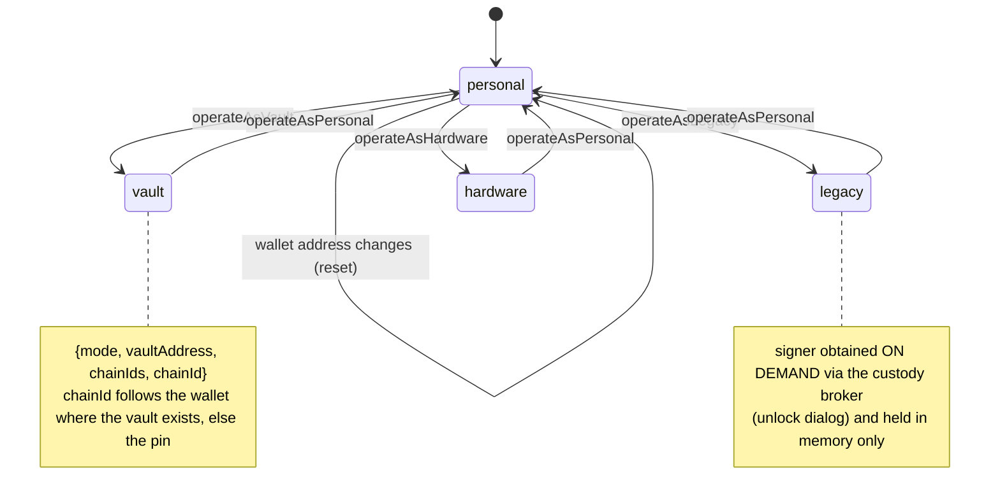

`hooks/useActiveAccount.js#submit(payload)` routes by identity through
`lib/custody/submitAsActiveAccount.js`:

| `active.mode` | Behaviour | Result |
|---|---|---|
| `personal` | The WalletContext signer sends. `payload.chainId` is asserted against the signer's network. | `{kind:'sent', txHash}` |
| `legacy` / `hardware` | `resolveActingSigner()` runs the deferred ceremony (unlock or connect device). A cached signer bound to a chain the wallet has left is dropped and re-requested. | `{kind:'sent', txHash}` |
| `vault` | `settleWalletOn(active.chainId)` runs, then a Safe proposal is created (`emitProposal` + `approveHash`). | `{kind:'proposed', safeTxHash, nonce}` |
| anything else (e.g. `derived`) | **Refused** (spec 088 FR-002). It never falls through to the connected signer. | throws |

---

## 4. Network selection

### 4.1 Where the target chain comes from

| Surface | Source of the target chain |
|---|---|
| My Wagers: Claim / Refund / Resolve | `useWagerChain().chainOf(market)` reads `market.chainId`. A legacy untagged cache entry falls back to the wallet chain. |
| Vault actions | `active.chainId`, or the queue row's own `chainId` (spec 102) |
| Wrap (spec 108) | The coin picked from `listWrappableCoins()`. Changing the coin **clears the amount**. |
| Earn / staking / supply | The vault's or pool's chain (`useEarnSend.sendOnChain`) |
| Swap / liquidity | The pinned pair chain (`PIN_MODE.SAME_NETWORK`) |
| Bridge | Source = asset chain; destination = same symbol on another chain (`PIN_MODE.OTHER_NETWORK_SAME_ASSET`) |
| Membership | `membershipChainId()` |
| BTC / SOL send | The string network id of the selected asset |

The pinning predicates live side by side in `lib/assets/networkPin.js`. Applying `samePair` to the
bridge would silently turn it into a same-chain transfer.

### 4.2 Rail resolution (before the tap)

`lib/chains/writeRail.js#resolveWriteRail({chainId, signer, loginMethod, chainName, walletChainId?, canSwitchChain?})`
returns `{rail, available, reason, reachability}`.

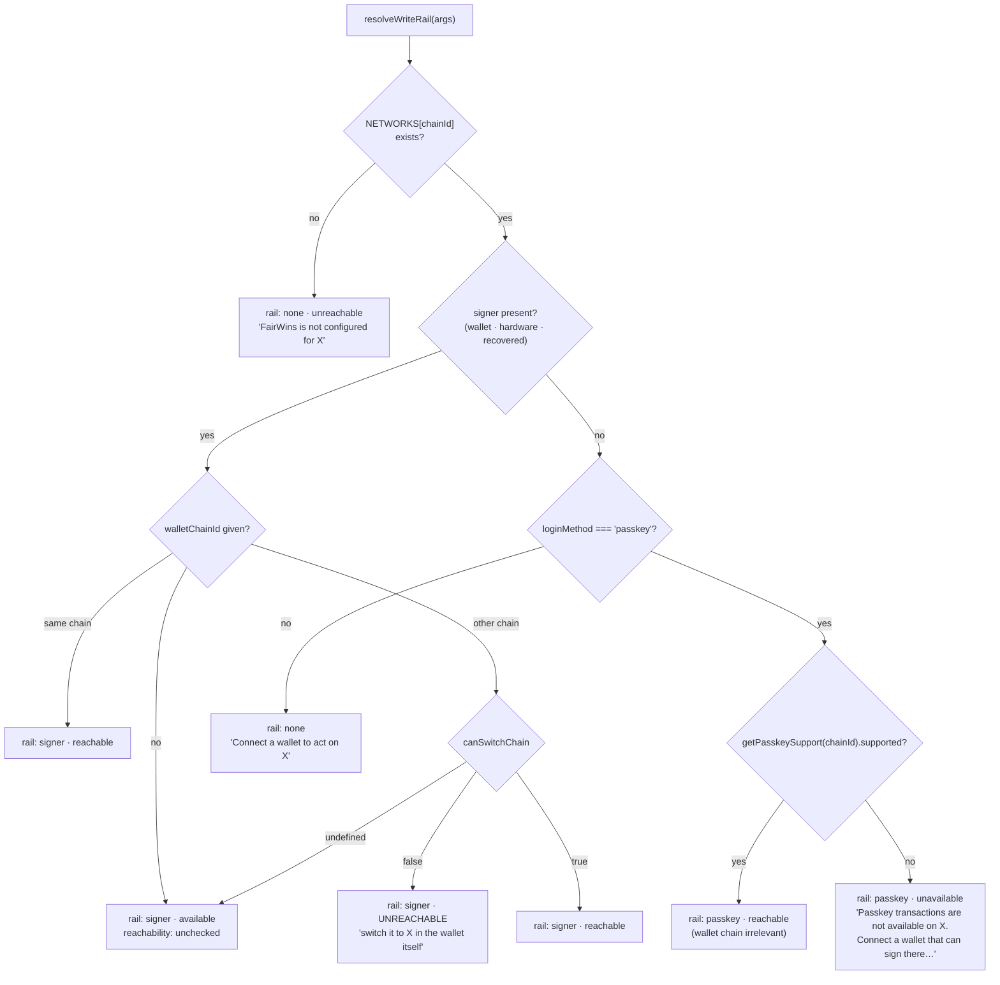

The signer is checked **before** `loginMethod`. A member holding a key (injected, Ledger,
recovered) can act on ETC even if they logged in with a passkey. `requireWriteRail` is the
throwing form used inside action callbacks, so a caller that gets past the UI fails with the same
sentence.

### 4.3 `submitOn`: the one place a write chooses its chain

`lib/chains/submitOn.js#submitOn(chainId, payload, io)`:

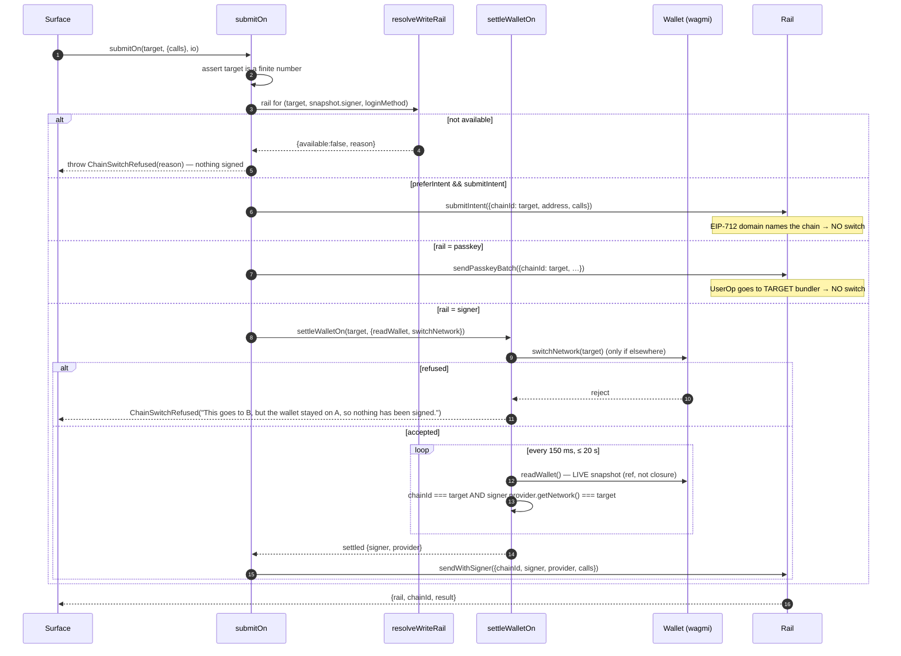

**Why the settled check also asks the signer.** Two facts update a beat apart:

1. The connector's `chainChanged` event updates `chainId`.
2. The chain-scoped signer is rebuilt by an async effect afterwards.

For that beat, the snapshot can pair the new chain with the old signer, and the transaction would
fail only *after* broadcast. The same `isSettled` test therefore guards both the early return and
the loop (issue #1627). The constants (`SETTLE_TIMEOUT_MS = 20_000`, `SETTLE_POLL_MS = 150`) exist
once; they replace three drifting copies.

`chainSwitchRefusal({to, from, chainName, subject})` is the one sentence composer, so surfaces that
run their own two-phase settle (for example `VaultQueueView`) speak the same words.

> **Transitional status (spec 110):**
>
> - **Done:** the ambient `useChainId()` hook is lint-banned (T030); wagers carry their chain
>   (T040).
> - **In progress:** moving the remaining signer call sites onto `submitOn` and emptying the
>   ethers allowlist (T028, 67 → 19 files).
> - **Not yet done:** retiring the remaining member-facing switch call sites (T041).
>
> Until T028 lands, a few hooks compose `settleWalletOn` + `sendCalls` themselves
> (`useEarnSend`, `useWrapNative`, `useVaultDeployment`, `useActiveAccount`, `useWagerChain`).
> They share the loop and the refusal wording, not just the idea.

### 4.4 Rail × chain matrix (what needs a wallet switch)

| Rail | Wallet switch? | Why |
|---|---|---|
| Passkey UserOp | **Never** | `sendPasskeyBatch({chainId})` posts to the target chain's bundler |
| Relayed EIP-712 intent | **Never** | `chainId` is in the signature domain; the gateway submits |
| Signer (injected / WalletConnect) | **Once per chain change** | A wallet broadcasts on the network it is on |
| Hardware / recovered | Signer bound at ceremony time to the wallet's current chain | A stale binding is dropped and re-requested; `payload.chainId` is asserted |
| Vault (Safe) | Like the signer rail, for `approveHash` / `execTransaction` | The SafeTx hash is chain-scoped |
| Bitcoin / Solana | n/a | Local keys; the gateway or cluster RPC is chosen by the network id |

---

## 5. Screening and enrichment

### 5.1 Screening has three layers; only the last one enforces

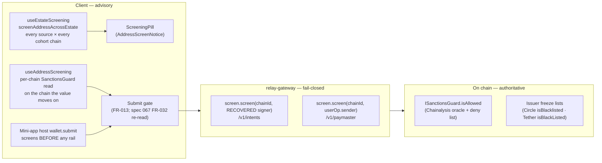

**Estate screening** (`lib/screening/`). `sources.js` lists every source per chain:

- the FairWins `SanctionsGuard` where deployed;
- the Chainalysis oracle (Base is at a different address);
- native issuer freeze lists.

`screenEstate.js` is:

- cohort-bounded;
- failure-isolated per source;
- deadline-bounded at **8 s** (`DEFAULT_DEADLINE_MS`);
- cached per address for `SCREENING_TTL_MS` with in-flight de-duplication.

It never rejects. The verdict is **derived, never stored** (`verdict.js#deriveVerdict`):

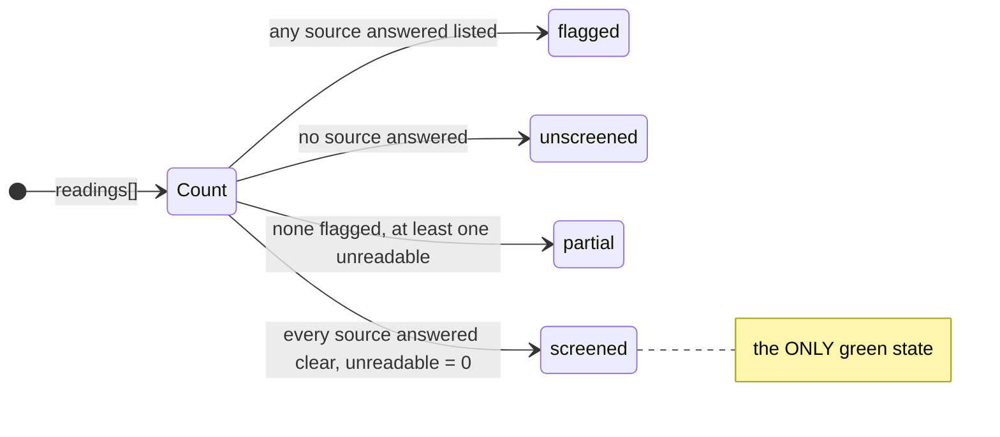

A chain with no configured source is **uncovered**, never clear. `getVerdictOn` has a third
answer, `no-source`, distinct from a verdict and from a still-running `null`.

**Gateway screening** (`services/relay-gateway/src/policy/sanctions.js`) screens the signer
**recovered from the signature**, never a client-asserted address:

- guard says no → `403 sanctioned_signer`;
- guard unreachable or unconfigured → `503 screening_unavailable`. The gateway never assumes
  "probably fine".

A contract revert caused by the guard is decoded client-side by `lib/wagers/sanctionsRevert.js`
(`SANCTIONED_ADDRESS_SELECTOR = '0x80279111'`).

### 5.2 Enrichment (making a raw call legible)

Enrichment runs at two moments: **before signing**, to describe what is being signed, and
**after settlement**, to turn logs into ledger rows.

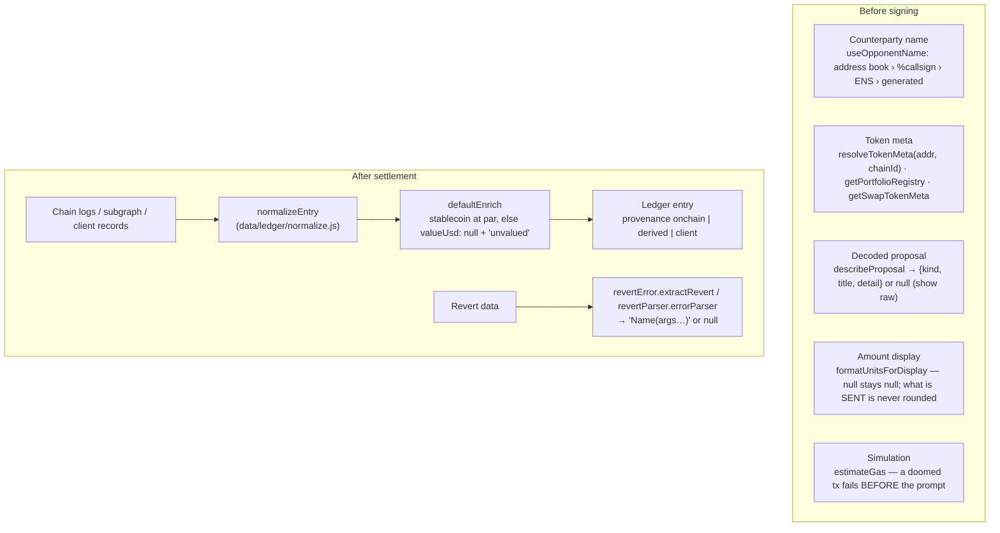

Enrichment rules:

- **Names are display-only.** An address is a hint until confirmed (spec 104). A callsign never
  gates a value path (spec 054).
- **A decoder answers `null` rather than guess.** `describeProposal` returns `null` when token
  metadata is unknown, and the queue shows raw calldata.
- **Valuation is honest.** Ledger entries carry `valuationStatus: 'valued' | 'unvalued'`, and
  `valueUsd` is `null` when unvalued.

---

## 6. Fee and price estimation

A confirm screen can carry up to five distinct cost facts. They are never collapsed into one
number.

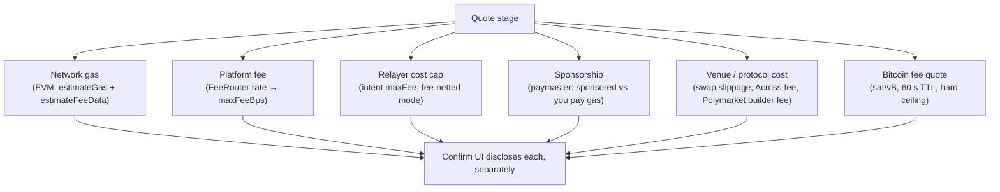

### 6.1 EVM network gas

- **Gas limit.** `lib/chains/walletSigner.js#sendTransaction` calls `publicClient.estimateGas`
  when no `gasLimit` is supplied ("DIVERGENCE 25"). This keeps ethers' behaviour: a transaction
  that would revert **fails before the wallet prompt**, and the 90 000-gas JSON-RPC default never
  under-gases a write. The differential test pins the RPC sequence
  (`eth_estimateGas` → `eth_sendTransaction` with `gas`).
- **Fee per gas.** `lib/chains/feeData.js#estimateFeeData(client)` deliberately reproduces ethers'
  policy (DIVERGENCE 28):
  - On EIP-1559 chains: `maxFeePerGas = baseFee × 2 + tip`. The tip comes from
    `eth_maxPriorityFeePerGas`, defaulting to 1 gwei. This is 2× headroom, not viem's 1.2×.
  - On legacy chains, and when `baseFee === 0n` (ETC 61, Mordor 63): `gasPrice` only, and
    `maxFee`/`tip` are `null`. viem would *throw* here.
- **Polygon floor.** `utils/feeOverrides.js#getFeeOverrides` sets a 30 gwei minimum priority
  fee on 137/80002 only; elsewhere it returns `{}`.
- **Who fills what.** An **injected wallet** fills nonce and fees itself. A **recovered key**
  (`localKeySigner.js`) uses viem `prepareTransactionRequest` plus a nonce manager whose
  `nonceFloor` closes the nonce-0 race (approve-then-pay). A **hardware** signer prepares, signs,
  verifies, then sends raw.

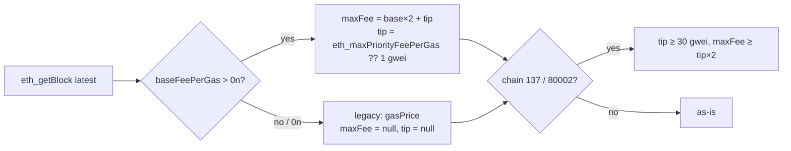

### 6.2 Platform fee (spec 060 FeeRouter)

`lib/fees/feeQuote.js`:

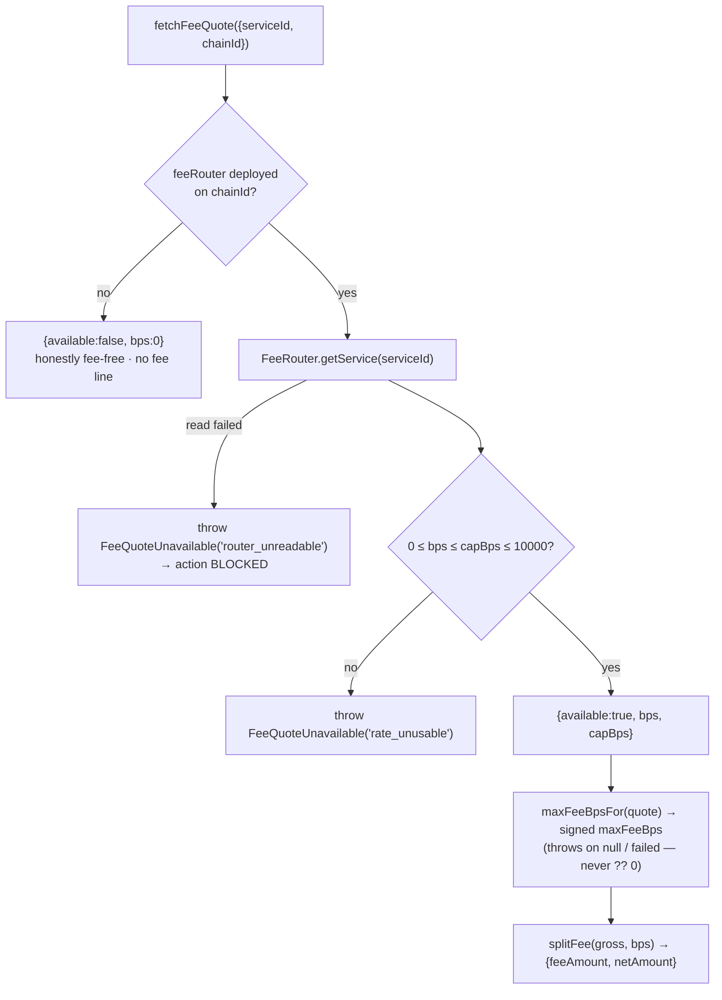

The member's `maxFeeBps` is a **consent ceiling**: the contract can never charge above what was
shown. A rate of zero means no fee line and behaviour identical to before spec 060. The gateway
reads the same router (`services/relay-gateway/src/fees/onchain.js`, 30 s cache, stale ≤ 10×TTL,
clamped to per-service caps) and never stores a second rate.

### 6.3 Relayer and paymaster cost

- **Relayed intents.** The gateway calls `estimateCostWei` against the target chain. In
  `fee-netted` funding mode, an estimate above the intent's signed `maxFee` returns
  `402 fee_exceeds_cap` and **no funds move**. A per-chain spend cap (`createSpendTracker`) bounds
  the sponsor.
- **Passkey UserOps.** `buildAccount` attaches the paymaster when the network has a
  `sponsorPaymasterUrl`. The bundler client estimates against a stub signature from
  `pm_getPaymasterStubData`.
  - If sponsorship is refused for a sponsorship reason (`AA3x`, "paymaster deposit too low"),
    `sendPasskeyBatch` rebuilds **without** the paymaster and retries once, emitting
    `sponsored: false`.
  - Simulation reverts (`AA1x`/`AA2x`, "execution reverted") are **not** retried; they are real
    failures.
  - The progress overlay discloses "Gas sponsored" or "You pay gas"; the transfer form badges
    "⚡ Gasless · sponsored".

### 6.4 Bitcoin and Solana

- **Bitcoin.** `gatewayClient#getFees` → `GET /v1/bitcoin/:network/fees` returns
  `{rates:{fast, normal, slow}, tipHeight}`. The gateway clamps rates to 1…500 sat/vB with a 30 s
  cache.
  - `prepareSend` builds a plan, or refuses with `stale_fee_quote` once
    `FEE_QUOTE_TTL_MS = 60_000` has passed.
  - The member-confirmed `feeSats` is a **hard signing ceiling**: `buildAndSignTx` throws
    `FeeOverrunError` above it.
  - BTC sends are never gasless.
- **Solana.** The member is the fee payer and the UI says so. No fee estimate is fetched today.

### 6.5 Prices (USD figures)

| Source | Used for | Behaviour on failure |
|---|---|---|
| `lib/portfolio/prices.js#fetchPortfolioPrices`: Chainlink `CHAINLINK_FEEDS` first, then Uniswap/ETCswap V3 `slot0` vs the chain stablecoin | Portfolio, asset sheets, BTC confirm (`usdPerBtc`) | Stale feed (> 24 h) or `≤ 0` is rejected; unpriced symbols are **absent** from the map. Stablecoins are valued at par $1. |
| `lib/uniswap/quote.js#quoteBestRoute` (QuoterV2 across fee tiers) | Swap confirm: `amountOut`, `minimumReceived`, `priceImpactPercent`, `gasEstimate` | `priceImpactPercent: null` if the reference quote fails |
| Across quote via `GET /v1/bridge/:chainId/quote` | Bridge confirm (the client adds the platform fee line) | Gateway error state |
| `data/reports/valuation.js` (`par-1usd-v1`) | Statements and ledger valuation | Non-stable assets are `unvalued` |

Fiat on a confirm screen is **omitted when unknown**, never faked: `BitcoinSendPanel` takes
`usdPerBtc ?? null`, and asset sheets guard `formatUsdFull` with `!= null`.

> **Known deviations from the null-not-zero rule** (tracked here so they are not copied):
> - `hooks/usePriceConversion.js` (legacy POL/USD from CoinGecko, polled every 5 min) falls back
>   to a hard-coded `0.5`, and `convertToUsd` returns `0` when no rate exists.
> - `lib/account/ledgerAdapters.js` maps `usdValue: e.valueUsd ?? 0`.
>
> New code should read `fetchPortfolioPrices` and keep `null`.

---

## 7. Signing

### 7.1 What is signed, per rail

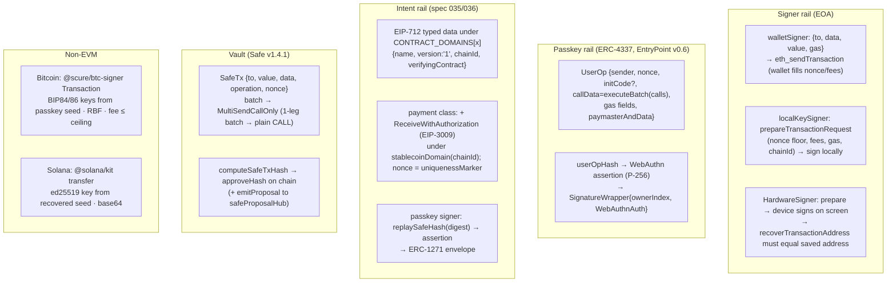

### 7.2 Typed-data correctness

The EIP-712 structs have **one source**: `@fairwins/intent-types`. They are checked against the
contracts by `test/intent/TypehashParity.test.js`.

`walletSigner.signTypedData` derives the primary type with `primaryTypeOf` (the type no other type
references). It never uses `Object.keys(types)[0]`, which could name a sub-type and produce a
valid signature over the wrong structure.

The **domains** (`name`/`version`) are still hand-synced, and nothing ties them to the verifying
contract (issue #1038). A correct type table under a wrong domain still produces an invalid
signature.

### 7.3 Vault proposals

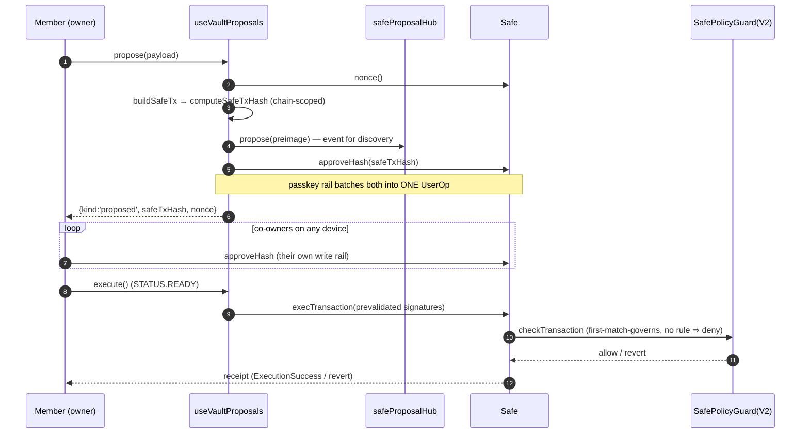

---

## 8. Broadcast

### 8.1 Signer rail

The wallet (or `sendRawTransaction` for local and hardware keys) broadcasts to its RPC.
`walletSigner` returns `{hash, wait(confirmations)}` as soon as the wallet returns the hash.
viem's `waitForTransactionReceipt` handles replacement detection.

### 8.2 Passkey rail

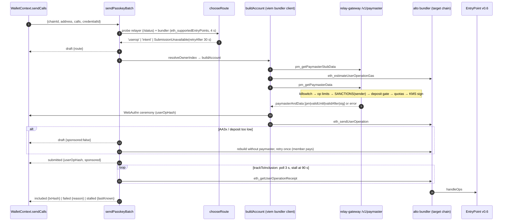

Two points to remember:

- An on-chain UserOp revert **returns** `{state:'failed'}`; it does not throw. Only pre-submit and
  submit errors throw.
- `bundlerTransport` fails over across several bundler URLs, except on terminal JSON-RPC codes
  (`-32500…-32507`, `-32521`, `-32602`, `-32601`).

### 8.3 Intent rail (gasless relay)

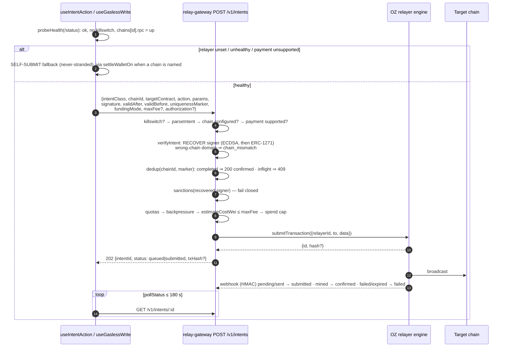

Every rejection carries a code the client can act on:

| Code | Meaning |
|---|---|
| `killswitch_active` | Relaying is disabled |
| `chain_mismatch` | Signed for a different chain |
| `payment_unsupported_on_chain` | The stablecoin lacks EIP-3009 |
| `sanctioned_signer` / `screening_unavailable` | Screening refused, or could not run |
| `quota_exceeded` / `backpressure` | Retry with `Retry-After`, or self-submit |
| `fee_exceeds_cap` | No funds moved |
| `chain_unavailable` | The engine is down; self-submit |

The client maps `429`/`503`/network errors to `RelayerUnavailable` (offer self-submit) and other
non-2xx responses to `RelayRejected`.

Peer-to-peer EIP-3009 transfers (`lib/transfer/eip3009Transfer.js`) post to a separate
`VITE_TRANSFER_RELAYER_URL`, not to the gateway.

### 8.4 Bitcoin and Solana

- **Bitcoin.** `executeSend` signs, then calls `broadcast(network, rawTxHex)` → `POST /v1/bitcoin/:network/tx`.
  It returns `{ok:true, txid, feeSats, lockedOutpoints}` or `{ok:false, error}`. Spent outpoints
  are locked until confirmation, and receive addresses rotate (the cursor never decreases).
- **Solana.** `sendSol` calls `getLatestBlockhash`, then `sendTransaction` with
  `skipPreflight: false`, and returns `{signature}`. The endpoint is the gateway proxy when
  configured, else the public cluster.

---

## 9. Tracking and final states

### 9.1 Unified progress

Passkey writes publish to `lib/passkey/txProgressBus.js`, which drives the global
`TxProgressOverlay` through four steps: Prepare → Sign → Submit → Confirm. The overlay
auto-dismisses 7 s after `confirmed` and links to the explorer.

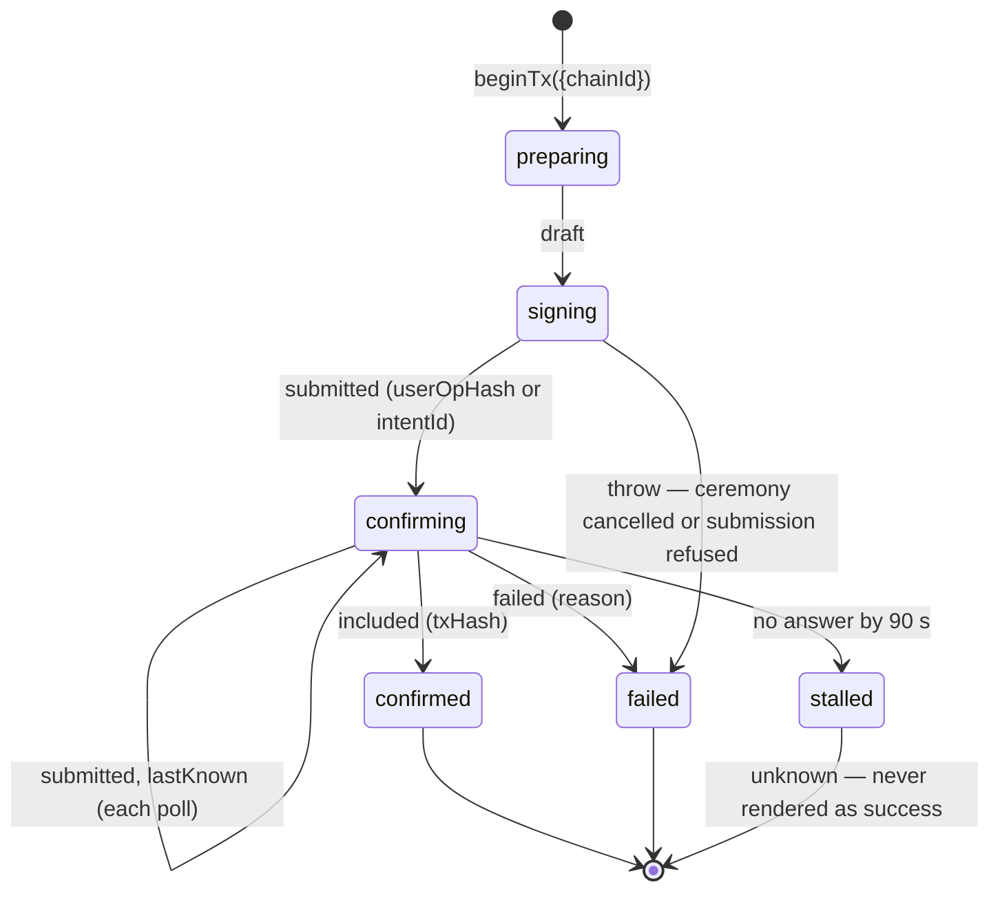

### 9.2 Final states by rail

| Rail | Success | Failure | Unknown / pending |
|---|---|---|---|
| Signer | `waitForReceipt` → receipt `status: 1` | `status: 0` throws `CALL_EXCEPTION`, decoded via `revertError` | — |
| Passkey | `included {txHash}` | `failed {reason}` (returned, not thrown) | `stalled {lastKnown}` |
| Intent | gateway `confirmed` (only on mined) | `failed`, or a `RelayRejected` code | `queued`/`submitted`; client `expired` at 180 s |
| Vault | `{kind:'proposed'}` → later `ExecutionSuccess` | guard or Safe revert | awaiting approvals |
| Mini-app `wallet.submit` | `SubmitResult.wait()` resolves at **broadcast + receipt** | rejects; `wait()` rejects for `proposed` | the app must race its own timeout |
| Bitcoin | `getTxStatus` → confirmed | `broadcast_rejected` / `signing_failed` | `found:false` (404) |
| Solana | `{signature}` returned | RPC error | status polling not wired yet |

The gateway reports `confirmed` **only** on mined or confirmed engine events (`engine/webhook.js`),
so it cannot report false success.

### 9.3 Recording what happened

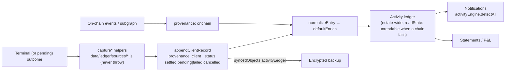

Capture helpers include:

- `captureEarnAction`, `captureStakingAction`, `captureLiquidityAction`;
- `captureBridgeSubmission` / `captureBridgeState`;
- `captureMiniAppTxSubmitted`;
- `captureLegacyRecovery`, which records an address and a type only, **never** key material.

---

## 10. End-to-end example: Claim a Base wager from a wallet sitting on Polygon

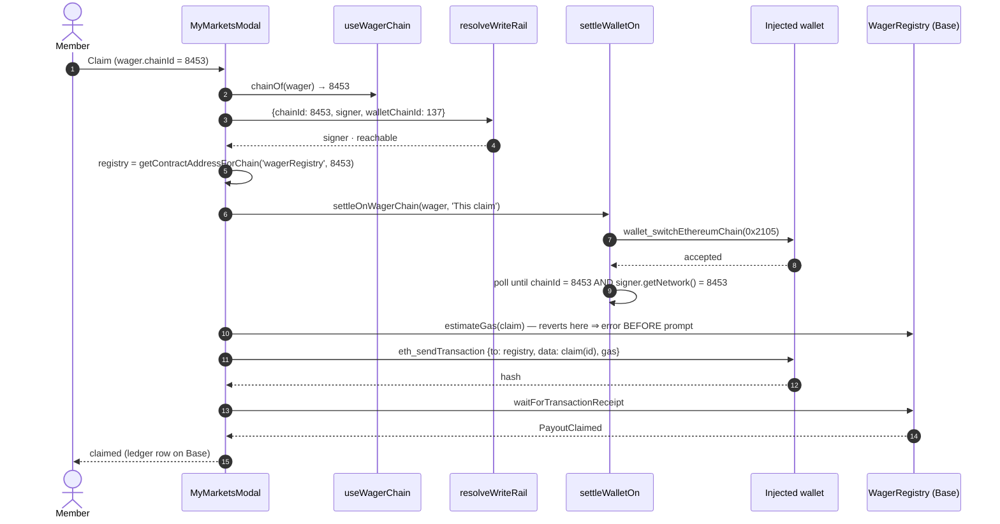

The same tap from a **passkey** member skips steps 6–9 entirely: `sendCalls(calls, {chainId: 8453})`
posts a UserOp to Base's bundler. On **ETC**, the same passkey member is told *before* the tap that
passkey transactions are unavailable there, and which wallet would work.

---

## 11. Refusal and error taxonomy

| Error | Raised by | Stage | Member-facing meaning |
|---|---|---|---|
| `ChainSwitchRefused {from, to}` | `submitOn`, `settleWalletOn`, `sendCalls` | Network selection | "This goes to B, but the wallet stayed on A, so nothing has been signed." |
| `resolveWriteRail` → `available:false` | `writeRail.js` | Pre-flight | Chain not configured / no passkey rail here / connect a wallet |
| `AccountUnresolved` | passkey connector | Identity | The account could not be confirmed on chain; recovery is offered |
| `FeeQuoteUnavailable` | `feeQuote.js` | Fees | The router is configured but unreadable or unsane; the action is blocked |
| `FeeOverrunError` | `bitcoin/psbt.js` | Signing | Actual fee > confirmed ceiling; nothing is broadcast |
| `InsufficientFeeBalance` | `passkey/submission.js` | Fees | The member cannot cover self-funded gas |
| `SubmissionUnavailable` | `chooseRoute` | Broadcast | Neither relayer nor bundler is reachable; retry in 30 s |
| `CeremonyCancelled` | passkey `getFn` | Signing | WebAuthn was dismissed |
| `HardwareWalletError` | `HardwareSigner` | Signing | The device signed with an unexpected account |
| `RelayerUnavailable` / `RelayRejected` | `intentClient.js` | Broadcast | Fall back to self-submit / a specific gateway code |
| `CALL_EXCEPTION` | `waitForReceipt` | Final state | Reverted on chain; decoded by `revertError` |

---

## 12. Checklist for a new write path

- [ ] The target chain comes from the **action/asset**, never `useChainId()` (lint-banned) or
      `getNetwork()`.
- [ ] Rail availability is resolved with `resolveWriteRail` and rendered **before** the button is
      enabled.
- [ ] The write goes through `submitOn` (or `settleWalletOn` + `sendCalls({chainId})` until T028
      closes). Never write a private switch loop.
- [ ] The acting identity goes through `useActiveAccount().submit`. Unknown modes refuse, never
      fall through.
- [ ] Every counterparty address is screened (estate pill, plus the per-chain gate on the value
      chain).
- [ ] Platform fees come from `fetchFeeQuote` → `maxFeeBpsFor`. Never hardcode bps.
- [ ] Gas: rely on the signer's estimate (a doomed transaction fails pre-prompt). Disclose
      sponsored vs member-paid.
- [ ] Prices and USD: `null` stays `null`; omit the figure rather than invent it.
- [ ] Track to a terminal state with the rail's own tracker. Never report success from submission
      alone.
- [ ] Record the outcome with a `capture*` helper; no key material in any record.
- [ ] Money-path flows get on-chain e2e coverage and a `matrix.json` row (spec 094).

## Source map

| Concern | Files |
|---|---|
| Write seam | `frontend/src/lib/chains/{submitOn,writeRail,walletSigner,localKeySigner,feeData,ethersCompat,publicClient}.js` |
| Identity | `contexts/{WalletContext,CustodyContext}.jsx`, `hooks/{useActiveAccount,useEffectiveAccount,useAccountSwitcher}.js`, `lib/custody/submitAsActiveAccount.js` |
| Storage | `lib/passkey/{credentials,prfKeys,accountLookup}.js`, `lib/recovery/legacyKeys.js`, `lib/hardware/hardwareAccountsStore.js`, `lib/custody/{vaultReferences,vaultCreationRecords}.js`, `lib/backup/` |
| Networks | `config/{networks,passkeySupport,networkCapabilities,bitcoinNetworks,solanaNetworks}.js`, `lib/network/rpcEndpoints.js` |
| Screening | `lib/screening/`, `hooks/{useAddressScreening,useEstateScreening}.js`, `services/relay-gateway/src/policy/sanctions.js` |
| Fees and prices | `lib/fees/feeQuote.js`, `utils/feeOverrides.js`, `lib/portfolio/prices.js`, `config/priceFeeds.js`, `lib/uniswap/quote.js`, `lib/bitcoin/send.js` |
| Passkey rail | `lib/passkey/{sendBatch,submission,smartAccount,bundlerTransport,intentSigner,txProgressBus}.js`, gateway `paymaster/` |
| Intent rail | `lib/relay/{intentClient,useIntentAction,useGaslessWrite,errors}.js`, `packages/intent-types`, gateway `server.js` `/v1/intents`, `intent/`, `policy/`, `engine/` |
| Vault | `hooks/useVaultProposals.js`, `lib/custody/{vaultTransaction,proposalHub,describeProposal}.js` |
| Tracking and ledger | `components/wallet/TxProgressOverlay.jsx`, `data/ledger/`, `data/notifications/` |
| Spec | `specs/110-multichain-write-seam/` (issue #1552) |
